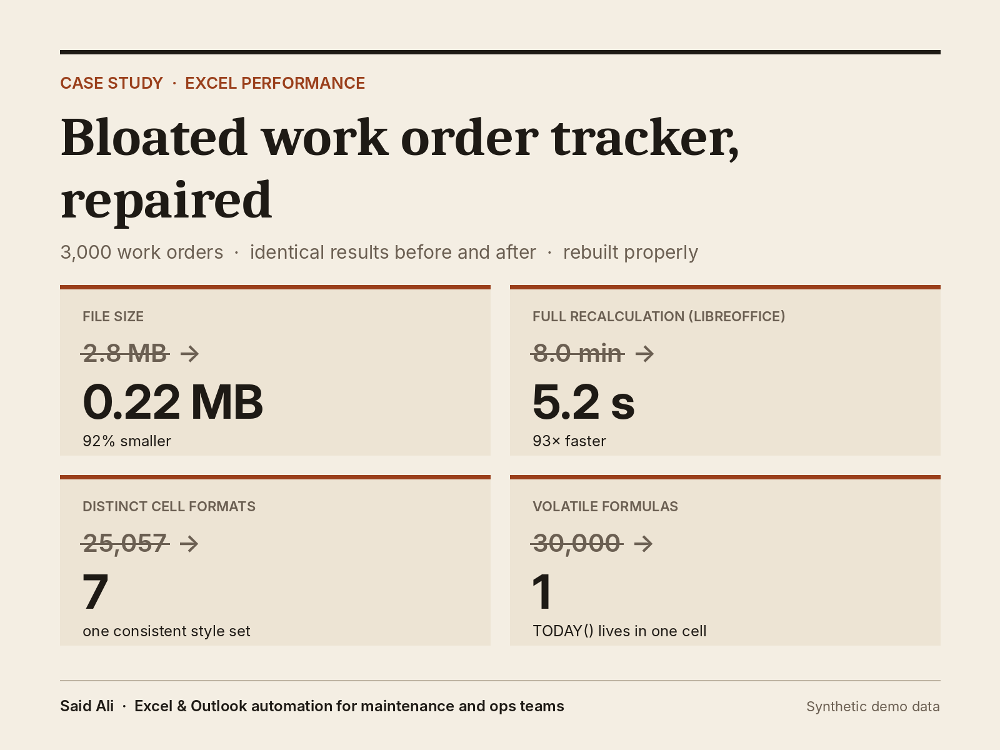

# Bloated Excel work order tracker, repaired

A maintenance work order tracker with 3,000 jobs had grown to almost 3 MB and froze
on every edit. This repo shows how I diagnosed it, rebuilt it, and proved the rebuilt
version gives exactly the same answers.



> **About the data:** every work order, site, asset and technician here is synthetic
> and generated by `demo/build_workbooks.py`. The bloat patterns are the ones I have
> diagnosed and fixed in real maintenance trackers; the data is not from any client
> or employer.

## Results

| | Before | After |
|---|---:|---:|
| File size | 2.79 MB | 0.22 MB |
| Used range | row 60,001 | row 3,001 |
| Cells stored | 943,017 | 45,565 |
| Formulas | 60,000 | 12,271 |
| Volatile formulas (TODAY, OFFSET, INDIRECT) | 30,000 | 1 |
| Formulas scanning whole columns | 20,000 | 0 |
| Conditional formatting rules | 753 | 3 |
| Distinct cell formats | 25,057 | 7 |
| Open + full recalculation (LibreOffice, headless)* | 483 s | 5.2 s |

\* LibreOffice timing includes starting LibreOffice (a few seconds on its own), so the
"after" figure is mostly startup. Excel timings are typically lower; see
[LOOM_SCRIPT.md](LOOM_SCRIPT.md) for how to time both files in Excel.

**Same answers:** all 3,000 rows were compared after recalculation: Days Open, SLA
status, age bucket, month, and open-job counts per site and per technician. Zero
differences.

## What was wrong

| Problem | Why it hurts |
|---|---|
| Borders and fills applied down to row 60,001 "for future data" | Excel saves, loads and scans 57,000 empty rows |
| Formulas dragged down to row 10,001 | 7,000 rows of formulas calculating nothing |
| `OFFSET`, `INDIRECT` and `TODAY()` in every row | Volatile: every formula recalculates on every single edit |
| Per-row `COUNTIFS` over whole columns (`C:C`) | 3,000 rows × 3 lookups, each scanning the entire used range |
| 753 conditional formatting rules in 377 fragments | Copy-paste splits rules; Excel evaluates all of them on screen refresh |
| 25,000+ distinct cell formats | Pasted formatting from many sources; slows saving and can hit Excel's format limit |

## How it was fixed

1. **Excel Table (`tblWO`)** holds the data. Calculated columns fill down automatically
   when a job is added, so nothing needs pre-dragging and there are no phantom rows.
2. **One `TODAY()`** in `Settings!B3`, named `ReportDate`. Every age and SLA calculation
   references it. Overwrite it with a date to re-run the tracker as of that day.
3. **Direct references** replace `OFFSET` and `INDIRECT`.
4. **Summary sheet** calculates open jobs per site (70) and per technician (200) once,
   over the table's columns, instead of 6,000 whole-column lookups on the log.
5. **Three conditional formatting rules**, scoped to the data: overdue rows, emergency
   priority, closed jobs greyed out.
6. **Seven cell formats** in total: one font, one date format, consistent alignment.

## tracker_doctor.py

A standard-library Python script that reads any `.xlsx` and reports these problems
without opening Excel or changing the file:

```
python tracker_doctor.py path/to/YourTracker.xlsx
python tracker_doctor.py path/to/YourTracker.xlsx --json report.json
```

Sample output: [reports/diagnosis_before.txt](reports/diagnosis_before.txt) and
[reports/diagnosis_after.txt](reports/diagnosis_after.txt).

## Repo layout

```
before/WO_Tracker_bloated.xlsx   the tracker as found
after/WO_Tracker_fixed.xlsx      the rebuilt tracker
tracker_doctor.py                diagnostic tool (no dependencies)
demo/build_workbooks.py          generates both workbooks from the same seeded data
demo/measure.py                  measures both files, writes reports/results.json
demo/make_cover.py               renders assets/cover.png from the results
reports/                         diagnosis output and measured results
LOOM_SCRIPT.md                   walkthrough script and Excel timing method
```

To rebuild everything: `pip install xlsxwriter openpyxl pillow`, then run
`python demo/build_workbooks.py` and `python demo/measure.py`.

## Need this for your own tracker?

Send a copy with dummy data and I'll reply with a diagnosis and a fixed-price quote.

Said Ali · Excel & Outlook automation for maintenance and operations teams
